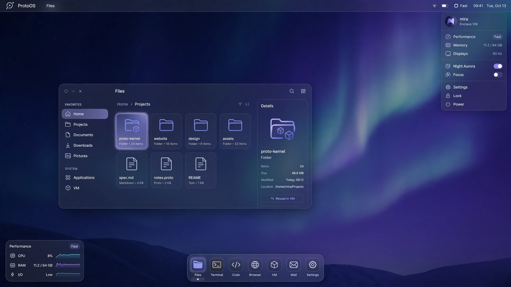

# ProtoOS Aurora — направление интерфейса

> **Статус:** утверждённое направление для следующего этапа ProtoOS KDE Edition.
>
> Приоритет пользователя: **максимальная отзывчивость** в Hyper-V, при этом система должна выглядеть законченной и самобытной. Целевая ВМ: 6–8 ГиБ RAM и 4 vCPU.

## Идея

**ProtoOS Aurora** — спокойный, собранный рабочий стол с тёмной северной палитрой: глубокий синий фон, холодные фиолетовые акценты и приглушённые поверхности. Компоновка использует понятные привычные ориентиры — тонкую верхнюю панель, рабочую область без визуального шума и компактную панель быстрого запуска — но не копирует macOS, Apple, GNOME или другой существующий продукт.

Макет выше — визуальная цель, а не скриншот готового интерфейса. В реальной сборке не должны появиться чужие логотипы, названия или ресурсы.

## Правило производительности

Hyper-V не предоставляет Linux-гостю полноценное аппаратное ускорение рабочего стола. Поэтому красота ProtoOS должна строиться на композиции, цвете, типографике и статических состояниях, а не на размытии и тяжёлом 3D.

| Допускается | Не используется по умолчанию |
| --- | --- |
| Чёткие скругления, контрастные границы, единая цветовая система | Постоянное размытие фона |
| Короткое появление меню/подсказки до 120 мс, если измеримо плавно | 3D-эффекты окон, "желе", куб рабочих столов |
| Статическая полупрозрачность, только если она не включает тяжёлую композицию | Прозрачность с живым blur, сложные тени, анимации при каждом движении |
| Компактная док-панель и ясные hover-состояния | Непрерывные виджеты с графиками на рабочем столе |

Профиль **Aurora Performance** для Plasma X11 внедряется в версии 0.4.1:

- композитор KWin выключен по умолчанию для сеанса Hyper-V;
- анимации окон, размытие, контрастный эффект и desktop effects не запускаются;
- остаются лёгкие визуальные состояния панели и приложений, которые не требуют постоянного рендеринга сцены;
- пользователь сможет включить расширенные эффекты вручную, но этот режим не будет считаться поддерживаемым для Hyper-V.

## Aurora Motion — 0.4.2

После подтверждения, что ВМ с 4096 МБ выделенной памяти работает плавно, появляется второй профиль: **Aurora Motion**. Он не превращает систему в тяжёлую 3D-витрину, а добавляет только понятные переходы:

- мягкое появление и закрытие окон;
- короткая анимация сворачивания/разворачивания;
- плавное появление системных меню и уведомлений;
- обзор окон для быстрого переключения приложений.

Для этого профиля включается OpenGL-композитор KWin, но blur, куб рабочих столов, magic-lamp и «желе»-окна остаются выключенными. Скорость переходов намеренно короче стандартной. Если на другой ВМ появятся задержки, `Alt+Shift+F12` мгновенно отключает композитор в Plasma X11.

## Icons & Proton — 0.4.3

Версия 0.4.3 заменяет стандартные пиктограммы базовых ролей на оригинальный набор **ProtoOS Aurora**: Файлы, Терминал, Текст, Документы и Настройки. Иконки — масштабируемые SVG, поэтому остаются резкими и на обычной панели, и в крупном launcher.

В док и меню добавляется **Proton Browser**. Его закрытый Linux `amd64` пакет берётся только из указанного владельцем публичного релиза и проверяется по закреплённому SHA-256. Сведения об источнике, версии и ограничениях доступны в [`third-party/Proton-browser.md`](third-party/Proton-browser.md).

## Aurora Welcome — 0.4.4

Версия 0.4.4 делает первый экран более понятным для человека, который впервые открыл Plasma:

- в начале док-панели находится **Начать работу** / **Get Started**, а не технический ярлык;
- локальный помощник открывает браузер, файлы, «Документы», настройки сети и оформления, а также объясняет Live-режим;
- создаются предсказуемые папки `Документы`, `Загрузки`, `Изображения` и другие XDG-папки в каждой Live-сессии;
- добавлены понятные роли и оригинальные иконки для изображений и архивов;
- базовые задачи не требуют терминала: просмотр изображений и работа с архивами доступны из меню.

Помощник не использует интернет, телеметрию или фоновую службу. Он запускается только по клику и остаётся доступен в панели приложений.

## Proton Flow — 0.4.5

ProtoOS 0.4.5 приводит системную поверхность к документированному языку взаимодействия Proton Browser: заметный фокус, компактные слои, ясные состояния и множество коротких переходов вместо случайной декоративности. Из публичных примечаний Proton перенесены именно эти принципы — плавные ненавязчивые переходы, необязательность тяжёлых креативных эффектов и уважение к уменьшению движения — без копирования закрытого исходного кода или чужих ресурсов.

- Цветовые схемы **ProtoOS Proton Dark** и **ProtoOS Proton Light** объединяют тёмные индиго-поверхности, сине-фиолетовый фокус, фиолетовый hover и мятный положительный статус.
- Icon theme `ProtoOS-Aurora` теперь наследует `breeze-dark`, `breeze` и `hicolor`. Это устраняет типичную причину пустых иконок: собственный набор заменяет только свои имена, а файловые, MIME и системные пиктограммы надёжно берутся из полного базового набора.
- Aurora Motion расширяется на обзор, сетку рабочих столов, смену рабочих столов, родительские диалоги, открытие/закрытие окон, maximize, popups, tiling hint и feedback запуска. Все переходы короче стандартных.
- Пользователь может открыть **Начать работу → Настроить эффекты окон**, уменьшить движение в системных настройках или мгновенно выключить композитор `Alt+Shift+F12`.
- Первоначально blur, 3D cube, magic lamp, fall-apart и wobbly windows были выключены ради Hyper-V; этот ранний профиль заменён Full Motion в 0.4.8 по прямому запросу пользователя.

## Clear Controls — 0.4.6

Главная навигация и настройки получают собственные понятные входы:

- безымянный launcher Plasma заменён на фирменную иконку дома с подписью **Home**; он по-прежнему открывает настоящее меню приложений и избранное, а не отдельную декоративную страницу;
- **Настройки** сначала показывают короткий выбор для сети, оформления, эффектов окон и полного System Settings. Это даёт новому пользователю ясный путь, не отнимая доступ к профессиональным настройкам Plasma;
- подписи системных действий в Home-меню включены, «недавно установленные» приложения не подсвечиваются в каждой новой Live-сессии, а категории не переключаются случайно при наведении.

## Foundation — 0.4.7

Версия 0.4.7 сначала исправляет практический дефект загрузки, а затем усиливает повседневную основу:

- `e2fsprogs` и `fsck.ext4` теперь входят в guest rootfs и каждый initrd; сборка завершается ошибкой, если checker не найден в initramfs. Это устраняет минутную задержку с `fsck ... exit status code 8` на `/dev/sda2`.
- Полноширинная верхняя панель становится лёгкой полупрозрачной строкой навигации; нижняя панель — центрированным плавающим dock только с приложениями. Это следует знакомой настольной эргономике, но использует оригинальные ProtoOS-акценты, а не ресурсы Apple.
- Кнопки закрытия, сворачивания и разворачивания размещаются слева ради привычной пространственной логики, но остаются стандартными доступными контролами Plasma.
- В основные повседневные инструменты добавляются калькулятор и `kio-extras` для удалённых/сетевых мест в Файлах.

## Full Motion & Familiar Tools — 0.4.8

Пользователь явно заменил прежнее ограничение на тяжёлые эффекты запросом включить **все анимации по умолчанию**. Поэтому Full Motion становится стандартным профилем: blur, contrast, cube, cube slide, magic lamp, fall apart, wobble, zoom, уменьшение неактивных окон, overview, grid рабочих столов, переходы рабочих столов, диалоги, popup и эффекты запуска активны сразу после входа.

Это намеренно визуально богатый профиль для выделенной ВМ. Быстрый путь назад сохраняется: `Alt+Shift+F12` выключает весь композитор, а **Настройки → Эффекты и анимации окон** управляют каждым эффектом отдельно.

Для знакомой повседневной работы в Home и помощник добавлены роли, узнаваемые пользователю Windows:

- **Этот компьютер** — устройства, диски и сетевые места;
- **Корзина** — просмотр и восстановление удалённых файлов;
- **Диспетчер задач** — процессы, приложения и нагрузка;
- **Калькулятор**;
- работа с сетевыми местами через SMB/SFTP и другие KIO-протоколы в Файлах.

Это знакомые роли, а не копирование логотипов или защищённого интерфейса Windows.

## Поверхность ProtoOS

| Область | Цель ProtoOS |
| --- | --- |
| Загрузка и вход | Название ProtoOS, Aurora-цвета, тихий экран входа без Debian/KDE-брендинга. |
| Панели и навигация | Одна узкая верхняя панель и компактный запуск приложений. Никаких лишних панелей по умолчанию. |
| Рабочий стол | Proton Dark по умолчанию, Proton Light как полноценная переключаемая схема. |
| Приложения | Простые видимые роли: **Файлы**, **Терминал**, **Текст**, **Документы**, **Настройки**. Системные пакеты сохраняются, но на поверхности не обязаны показывать технические имена KDE/Debian. |
| Системные диалоги | Единые термины ProtoOS для пользовательских действий: сеть, питание, дисплеи, оформление, сведения о системе. |
| Обновления/диагностика | Пока вне первого Live-релиза: система должна честно оставаться Live-сессией без постоянного хранения данных. |

«Убрать Linux» означает заменить **видимые название, навигацию и оформление**. Техническая основа остаётся Debian, Linux и KDE Plasma: это необходимо для безопасности, лицензирования, пакетов и совместимости с Hyper-V. ProtoOS не будет скрывать эту информацию в лицензиях, терминале или диагностике.

## Язык бренда

- **Имя продукта:** ProtoOS.
- **Редакция:** ProtoOS KDE Edition.
- **Режим:** ProtoOS Live Session.
- **Пользователь:** `protoos`.
- **Тема по умолчанию:** ProtoOS Proton Dark.
- **Светлая тема:** ProtoOS Proton Light.
- **Тон:** лаконичный, доброжелательный, без псевдотехнических маркетинговых надписей.

## Цвет и форма

- Фон: ночной индиго и сине-фиолетовая Aurora-градация.
- Акцент: холодный лавандовый; для положительных действий — сине-мятный.
- Ошибки: читаемый приглушённый коралловый, не ярко-красные заливки.
- Поверхности: различимы за счёт оттенка и тонкой рамки; не требуют GPU-размытия.
- Геометрия: радиус 10–14 px для окон и меню, 8–10 px для элементов управления.
- Отступы: сетка 4 px, базовый внутренний отступ 12–16 px.

## Этапы внедрения

1. **Aurora Performance (0.4.1):** воспроизводимый профиль Plasma X11, отключающий тяжёлые эффекты, минимальная раскладка панелей и ProtoOS-названия базовых приложений.
2. **ProtoOS shell:** локализованные пользовательские названия приложений, собственные launcher/menu/defaults, единая верхняя панель и док.
3. **Системная идентичность:** экран входа, загрузочный экран, About/System Settings и metadata.
4. **Aurora Motion, Icons & Proton (0.4.2–0.4.3):** после успешного пользовательского замера на Hyper-V включаются короткие KWin-переходы без blur и тяжёлых 3D-эффектов; оригинальные SVG-иконки и Proton Browser добавляются в основную навигацию. Пользователь в любой момент может отключить композицию сочетанием `Alt+Shift+F12`.
5. **Aurora Welcome (0.4.4):** конкретные ежедневные действия доступны из локального помощника, подписаны понятными ролями и не требуют знания KDE; заметно объясняется ограничение Live-режима.
6. **Proton Flow (0.4.5):** корректный fallback иконок, системная палитра Proton Dark/Light и расширенный набор кратких KWin-переходов; тяжёлые эффекты остаются выключены.
7. **Clear Controls (0.4.6):** подписанная кнопка Home открывает настоящее меню приложений, а Настройки дают короткий маршрут к частым действиям и полному System Settings.
8. **Foundation (0.4.7):** fsck.ext4 проверяется внутри каждого initrd до публикации; стандартная навигация становится верхним menu bar и центрированным floating dock, а набор ежедневных задач расширяется калькулятором и сетевыми местами.
9. **Full Motion & Familiar Tools (0.4.8):** все эффекты KWin включены по умолчанию по последнему запросу пользователя; Home и помощник получают Этот компьютер, Корзину и Диспетчер задач.

## Критерии готовности Aurora Performance

- вход в `protoos` открывает готовый к работе рабочий стол без лишних окон;
- первый клик по меню, панели и файловому менеджеру не требует ожидания;
- перемещение окна и переключение между приложениями остаются отзывчивыми на ВМ с 4 vCPU и 6–8 ГиБ RAM;
- переключение Proton Dark/Light не меняет брендинг и не запускает тяжёлую композицию;
- обычная Live-сессия не сохраняет данные пользователя после выключения.
